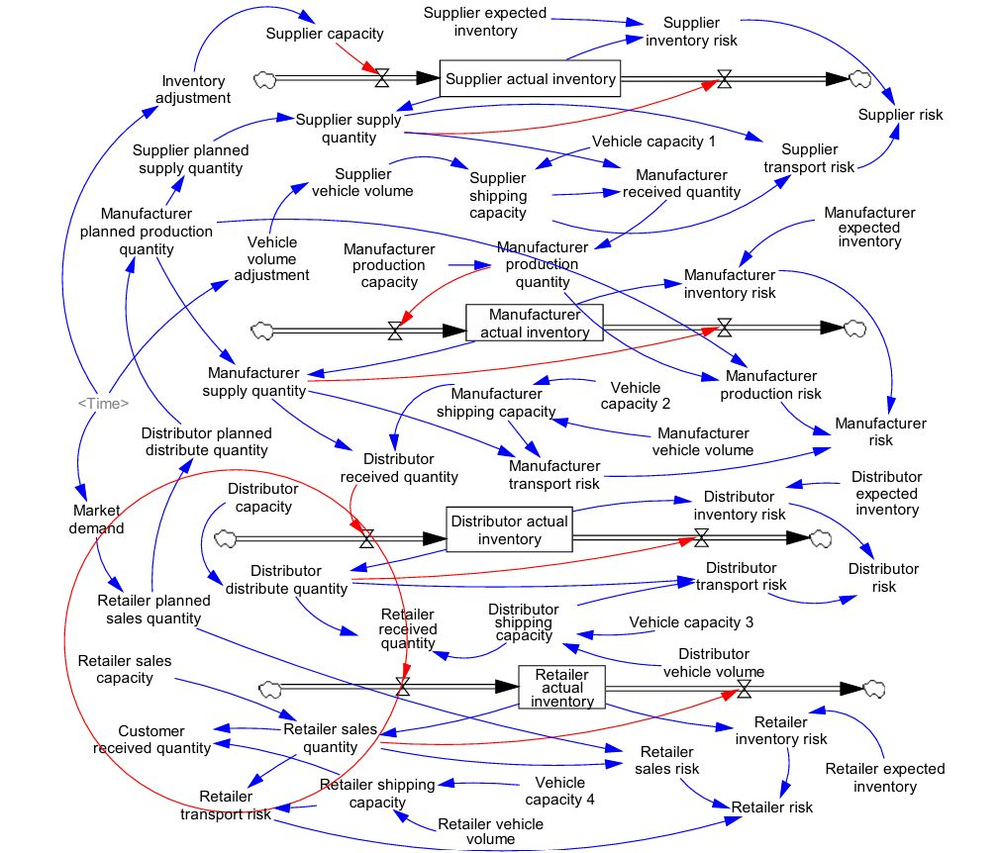
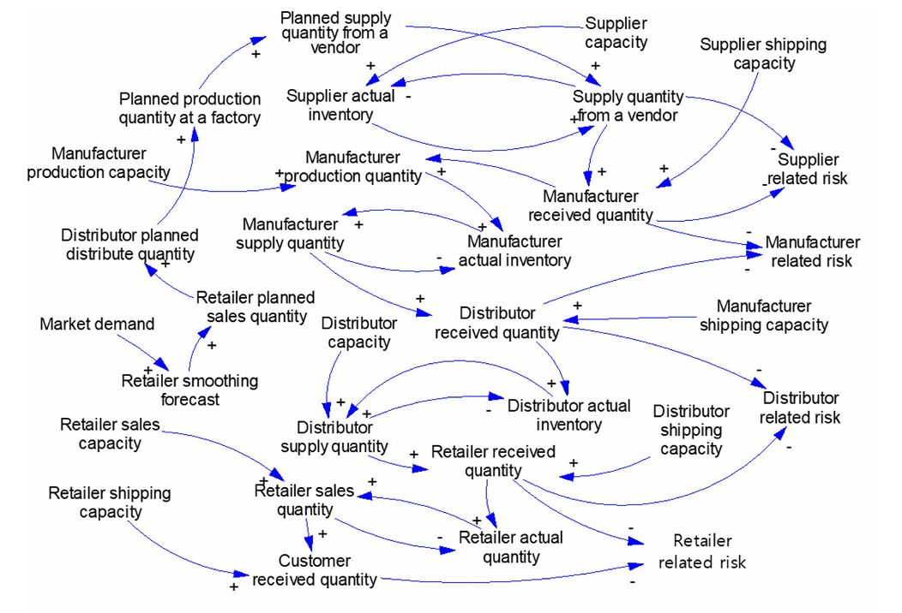
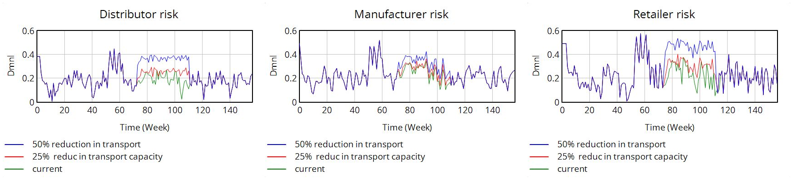
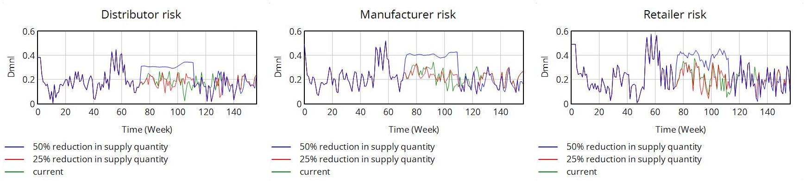
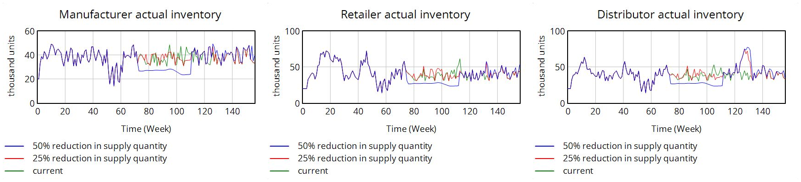
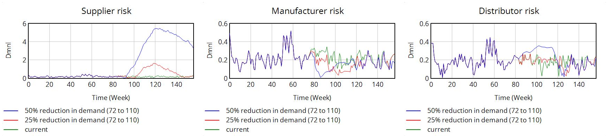
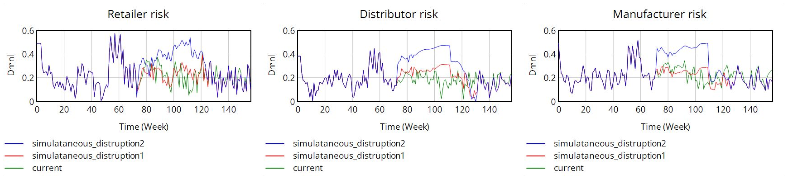

# Visualizing the Ripple Effect in Supply Chains under Disruptions

A **system-dynamics simulation** (built in **Vensim**) of a five-stage supply chain,
used to study how disruptions propagate — the **ripple effect** — and to measure which
nodes become most vulnerable under different disruption types, durations, and
combinations.

The model tracks a per-entity **vulnerability (risk) index** over a 156-week horizon
and compares it across four disruption scenarios against a no-disruption baseline.

> M.Sc. Phase I project, IIT Bombay (IE-685) — Industrial Engineering & Operations Research.

---

## Supply chain structure

```
Supplier → Manufacturer → Distributor → Retailer → Customer
```

Material flows **downstream** (supplier to customer); demand information flows
**upstream**. Each entity plans against a smoothed demand expectation (≈3-week
smoothing) before passing it to the next node, which dampens noise but also delays the
chain's reaction to shocks.

---

## How the model works

**1. Component risks.**
Each entity's vulnerability is built from the operational risks relevant to it, each
normalized to `[0, 1]`:

- **Inventory risk** = `|Actual Inventory − Expected Inventory| / Expected Inventory`
- **Transport risk** = `(Actual Output − Shipping Capacity) / Actual Output`, when output exceeds capacity (else 0)
- **Production risk** = `(Planned − Actual Production) / Planned Production`, when under plan (else 0)
- **Sales risk** = `(Planned − Actual Sales) / Planned Sales`, when under plan (else 0)

**2. Entity vulnerability index (weighted blend of component risks):**

| Entity       | Composition                                              |
|--------------|---------------------------------------------------------|
| Supplier     | Inventory (0.6), Transport (0.4)                        |
| Manufacturer | Production (0.5), Inventory (0.3), Transport (0.2)      |
| Distributor  | Inventory (0.6), Transport (0.4)                        |
| Retailer     | Sales (0.5), Inventory (0.3), Transport (0.2)           |

**3. System-dynamics structure.**
A **causal loop diagram** and a **stock-and-flow model** connect planned/actual
inventory, production, shipping capacity, and vehicle volumes across all five entities,
so a shock at one node propagates through stocks and flows to the others.



<details>
<summary>Causal loop diagram</summary>



</details>

---

## Simulation setup

| Parameter | Value |
|---|---|
| Horizon | 156 weeks (weekly time step) |
| Market demand | ~50,000 units/week, varying 70–130%, starting week 4 |
| Initial inventory (per entity) | 20,000 units |
| Expected inventory (per entity) | 55,000 units |
| Vehicle capacity | 2,500 units/vehicle |
| Vehicle volume (per entity) | 15–25 vehicles |
| Capacity adjustment | 35% reduction applied at week 50 |

---

## Disruption scenarios

Disruptions are injected between **weeks 72 and 110** at **25%** and **50%** severity,
and the resulting vulnerability indices are compared to the baseline:

1. **Shipping-capacity reduction** (manufacturer) — reduced outbound shipping capacity.
2. **Supply-quantity reduction** — reduced quantity supplied upstream.
3. **Market-demand disruption** — a drop in end-market demand.
4. **Simultaneous disruption** — shipping capacity, supply, and demand hit together.

---

## Results

Each panel plots an entity's vulnerability index over the 156-week horizon; the baseline
(*current*) is compared against **25%** and **50%** disruption severity.

**Scenario 1 — Manufacturer shipping-capacity reduction**



**Scenario 2 — Supply-quantity reduction**



Resulting inventory levels across the chain:



**Scenario 3 — Market-demand disruption**



**Scenario 4 — Simultaneous disruption**



---

## Key findings

- **Disruptions propagate in both directions.** Demand shocks begin downstream and
  cascade upstream; logistics/supply shocks originate upstream and push downstream.
- **Logistics (shipping-capacity) disruptions hit the retailer hardest** — delays and
  stock shortages at the customer-facing end.
- **Supply-quantity disruptions hit the manufacturer first**, then cascade to
  downstream nodes as inventory shortfalls.
- **Demand disruptions** leave the retailer relatively resilient (fast ~3-week demand
  adaptation) but raise distributor vulnerability through backlogged/excess inventory.
- **Simultaneous disruptions cause a larger ripple than any single disruption**, with
  **manufacturers and retailers the most fragile** nodes because they participate in the
  most supply-chain activities.
- **Longer-duration disruptions amplify the impact**, and recovery depends on risk type,
  resilience, and mitigation actions.

---

## Repository contents

```
ripple_effect_supply_chain.mdl        # Vensim system-dynamics model
figures/
  stock_flow_diagram.png
  causal_loop_diagram.png
  scenario1_shipping_capacity.png
  scenario2_supply_quantity.png
  scenario2_inventory_levels.png
  scenario3_market_demand.png
  scenario4_simultaneous.png
MSc_Phase_1.pdf                       # full project report / slides
README.md
```

*(Add the `.mdl` model file and the report yourself — the `figures/` images are included.)*

## How to run

1. Open `ripple_effect_supply_chain.mdl` in **Vensim** (the free *Vensim PLE* is enough
   to open and simulate the model).
2. Run the baseline, then apply each disruption scenario by editing the relevant
   capacity / supply / demand variables for weeks 72–110.
3. Compare the entity vulnerability indices across scenarios.

---

## Background

The model is informed by the system-dynamics and ripple-effect supply-chain literature
(e.g. Ghadge et al. on visualizing the ripple effect via a system-dynamics approach;
Ivanov, Dolgui, and colleagues on ripple-effect quantification and disruption
propagation).
